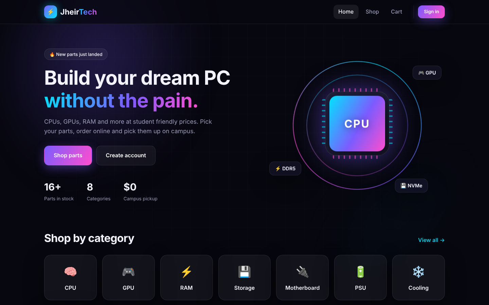
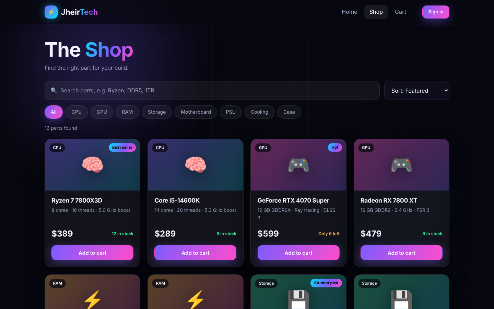
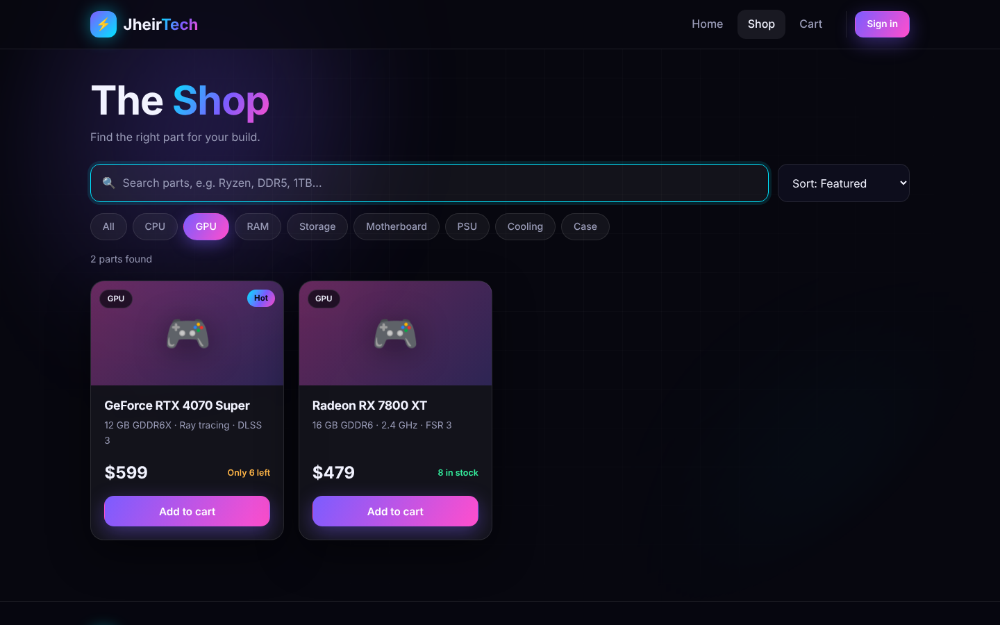
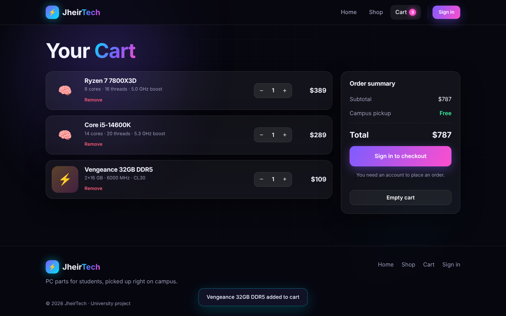
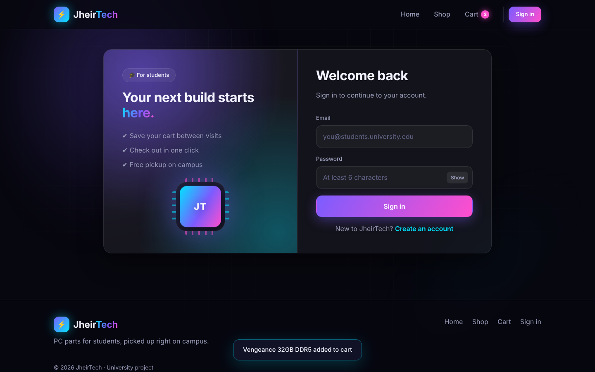
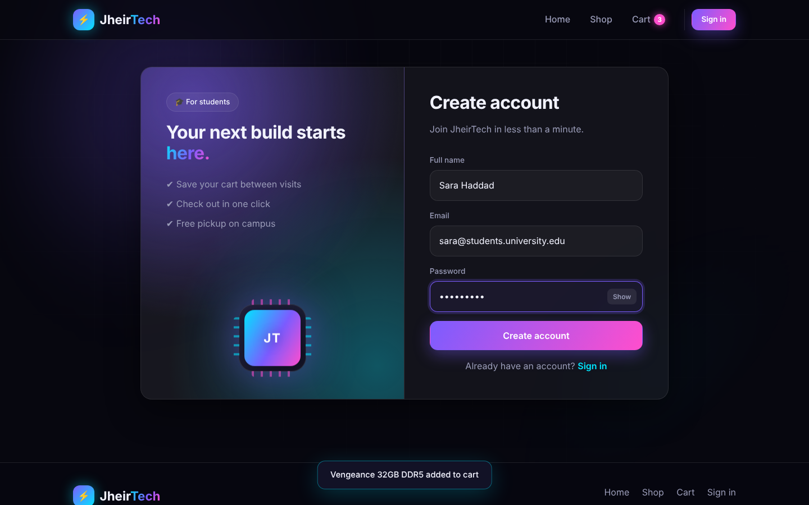
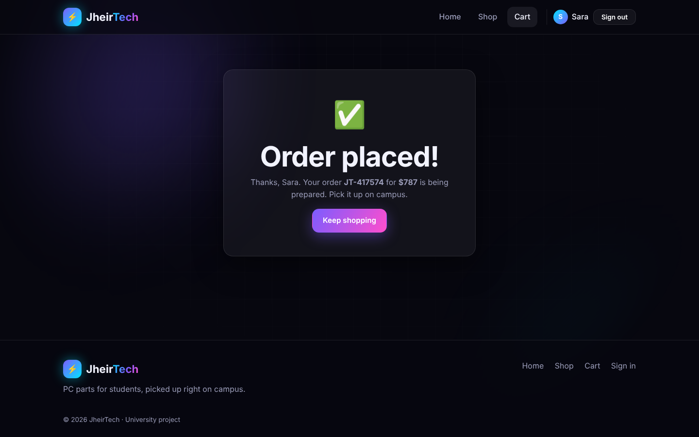
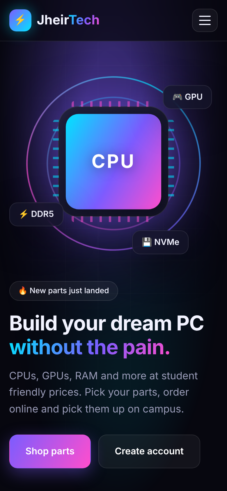
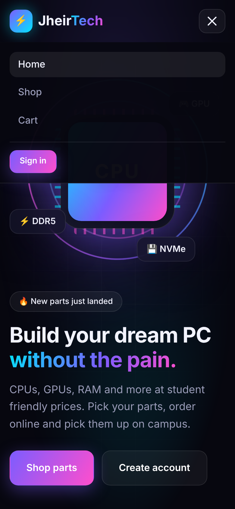

# JheirTech - PC Parts Store

**Live demo:** _add your Vercel / Netlify link here after deploying_

JheirTech is a single-page web app for selling PC components (CPUs, GPUs, RAM, storage, motherboards,
power supplies, coolers and cases) to university students. Visitors can browse and search the catalogue,
filter by category, sort by price, fill a shopping cart, and create an account or sign in to place an order
for pickup on campus. It was built as a university project with React and React Router.

## Features

- Home page with hero section, category tiles and featured products
- Shop page with live search, category filter and sorting (price, name)
- Shopping cart with quantity controls, stock limits and an order summary
- Sign in / Create account page with form validation (checkout needs an account)
- Cart, user and accounts are saved in the browser (`localStorage`)
- Responsive dark neon design with a mobile menu
- 404 page for unknown addresses

## Project rules

- Hooks used: `useState`, `useEffect`, `useContext` only
- Routing with `react-router-dom` (`BrowserRouter`, `Routes`, `Route`, `Link`, `NavLink`, `Navigate`) - no `useNavigate`
- Arrow functions everywhere
- Built with Create React App (`react-scripts`), no Vite

## Tech stack

React 18, React Router 6, Create React App, JavaScript (ES6+), plain CSS3 (variables, Grid, Flexbox, animations),
Google Fonts (Inter, Space Grotesk).

## Setup

You need [Node.js](https://nodejs.org) 18 or newer and Git.

```bash
git clone https://github.com/YOUR-USERNAME/jheirtech-store.git
cd jheirtech-store
npm install
npm start
```

Open http://localhost:3000. If `npm install` complains about peer dependencies, run
`npm install --legacy-peer-deps`.

To create a production build in the `build` folder:

```bash
npm run build
```

## Deployment

The app is a single-page app that uses `BrowserRouter`, so the host must send every address to `index.html`.
The repo already includes the settings for this.

**Vercel (recommended)**
1. Sign in at https://vercel.com with your GitHub account and click **Add New > Project**.
2. Import the `jheirtech-store` repository. Vercel detects Create React App by itself.
3. Click **Deploy**. `vercel.json` makes the page routes (such as `/shop`) work after a refresh.

**Netlify**
1. Sign in at https://netlify.com and click **Add new site > Import an existing project**.
2. Pick the GitHub repository. The build command (`npm run build`) and publish folder (`build`) come from `netlify.toml`.
3. Click **Deploy**. `public/_redirects` handles the page routes.

## Screenshots

| Home | Shop |
| --- | --- |
|  |  |

| Category filter (GPU) | Cart |
| --- | --- |
|  |  |

| Sign in | Create account |
| --- | --- |
|  |  |

| Order placed |
| --- |
|  |

| Mobile home | Mobile menu |
| --- | --- |
|  |  |

## Project structure

```
public/index.html            HTML shell and fonts
src/index.js                 React root
src/App.js                   Router and routes
src/context/AppContext.js    Global state: user, cart, category, toast
src/data/products.js         Product list and categories
src/components/              Navbar, Footer, ProductCard
src/pages/                   Home, Shop, Cart, SignIn, NotFound
src/styles.css               Design tokens and all styling
docs/                        Project report (PDF) and screenshots
```

## Documentation

The full project report (abstract, system design, technologies, code snippets) is in
[`docs/JheirTech_Project_Report.pdf`](docs/JheirTech_Project_Report.pdf).

## Notes and limitations

- This is a front-end demo. Accounts live in the browser and passwords are stored without encryption, so do not
  use real passwords. A real shop needs a server and a database.
- Edit products, prices and stock in `src/data/products.js`. Colors are CSS variables at the top of `src/styles.css`.
